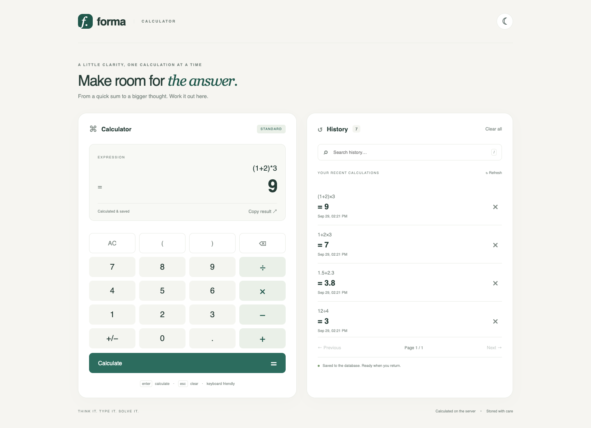
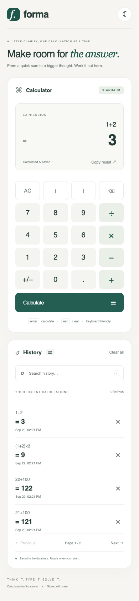

# Forma Calculator · Frontend

A responsive Vite + vanilla JavaScript calculator for **<REPLACE_WITH_MY_STUDENT_ID> · <REPLACE_WITH_MY_NAME>**.
Repository: TODO_FRONTEND_REPOSITORY_URL

## Features

Four-operation expression entry, parentheses, unary signs and decimals; server-calculated results; searchable paginated database history; delete and confirmed clear-all; keyboard shortcuts; persistent light/dark preference; copy result; history reuse; loading and accessible inline errors.

## Stack and architecture

Vite, JavaScript ES modules, semantic HTML and CSS variables. Native `fetch` is the only calculation path. The browser edits text and displays the API result; it never evaluates arithmetic. The FastAPI implementation belongs in a separate repository.

## Local setup

Install Node.js 22.12+ (tested: 24.19.0) and npm. Start the backend separately on port 8000.

```bash
npm ci
cp .env.example .env
npm run dev
```

Open http://localhost:5173. `.env` uses `VITE_API_BASE_URL=http://localhost:8000`. This value is public build-time configuration, never a place for credentials.

## Build, tests, formatting

```bash
npm test
npm run format:check
npm run build
npm run preview
```

`dist/` is the static deployment output. Set `VITE_API_BASE_URL` **before** building; rebuild after changing it. Serve over HTTPS and configure the exact frontend origin in the backend's `FRONTEND_ORIGINS`. To call the backend from the default preview port, include `http://localhost:4173` and/or `http://127.0.0.1:4173` in that setting.

## Project structure

| Module | Responsibility |
|---|---|
| `src/main.js` | Compose modules |
| `src/api.js` | JSON API requests, timeouts and readable errors |
| `src/calculator.js` | Text editing, request state, server result display |
| `src/expression.js` | Display operators and predictable sign text transformation |
| `src/history.js` | Database-backed listing, search, pagination and deletion |
| `src/keyboard.js` | Keyboard input without interfering with search or dialogs |
| `src/theme.js` | Theme selection; the only use of localStorage |
| `src/styles.css` | Responsive layout, CSS variables and focus styles |

## Usage

Type an expression or click buttons. Enter / `=` submits; Escape clears; Backspace edits. Click a history item to reuse its expression. For a plain number, `+/−` toggles its leading minus; for a compound expression it wraps the entire text in `-(...)`. It does not calculate or guess the current operand. Unary signs, parentheses and precedence are handled on the server. Expressions are limited to 200 characters.

Repeated submissions are blocked while a request is running. If the text changes during a request, the old result is not displayed against the new expression. History data always comes from the API; refresh and browser reopen preserve it because the database persists.

## Backend API

| Method | Endpoint | Purpose |
|---|---|---|
| GET | `/api/health` | Service/database health |
| POST | `/api/calculate` | `{ "expression": "(1+2)*3" }` → result `"9"` |
| GET | `/api/history?page=1&page_size=20&search=` | Newest-first history |
| DELETE | `/api/history/{id}` | Delete actual record |
| DELETE | `/api/history` | Clear shared history after confirmation |

## Verification

Two unit tests pass and the production build passes. The complete assignment contains `scripts/browser_acceptance.mjs`: real Chrome tests use isolated ports 8011/5175 and an isolated SQLite database, save 24 screenshots, and actually stop/restart servers. Run from the assignment root with `node scripts/browser_acceptance.mjs`; both repositories and an installed Chrome are required. See the accompanying submission evidence for the actual checks.

## Deployment

Upload `dist/` to any static host (build `npm ci && npm run build`, publish `dist`). `netlify.toml` is an optional provider example. Set `VITE_API_BASE_URL` to the public HTTPS backend URL and redeploy. Current deployment: TODO_FRONTEND_DEPLOYMENT_URL.

## Limitations

This coursework uses one shared history database, without user accounts. Clear-all applies to everyone using that backend. Clipboard access requires a secure browser context. No frontend arithmetic fallback exists when the backend is offline. Fonts use local system fallbacks so the calculator does not depend on external font services.

Code conventions: [codestyle.md](codestyle.md).

## Screenshots





## Troubleshooting

- If calculation fails, visit the backend `/api/health` and check that the backend is running.
- If the browser reports CORS, add its exact origin (including port) to `FRONTEND_ORIGINS` and restart the backend.
- `VITE_API_BASE_URL` is read at build/start time; restart Vite or rebuild after editing it.
- HTTPS pages require an HTTPS API. `localhost` in a deployed build refers to the visitor's machine.
- Theme preference is optional; disabling localStorage does not disable the calculator.
